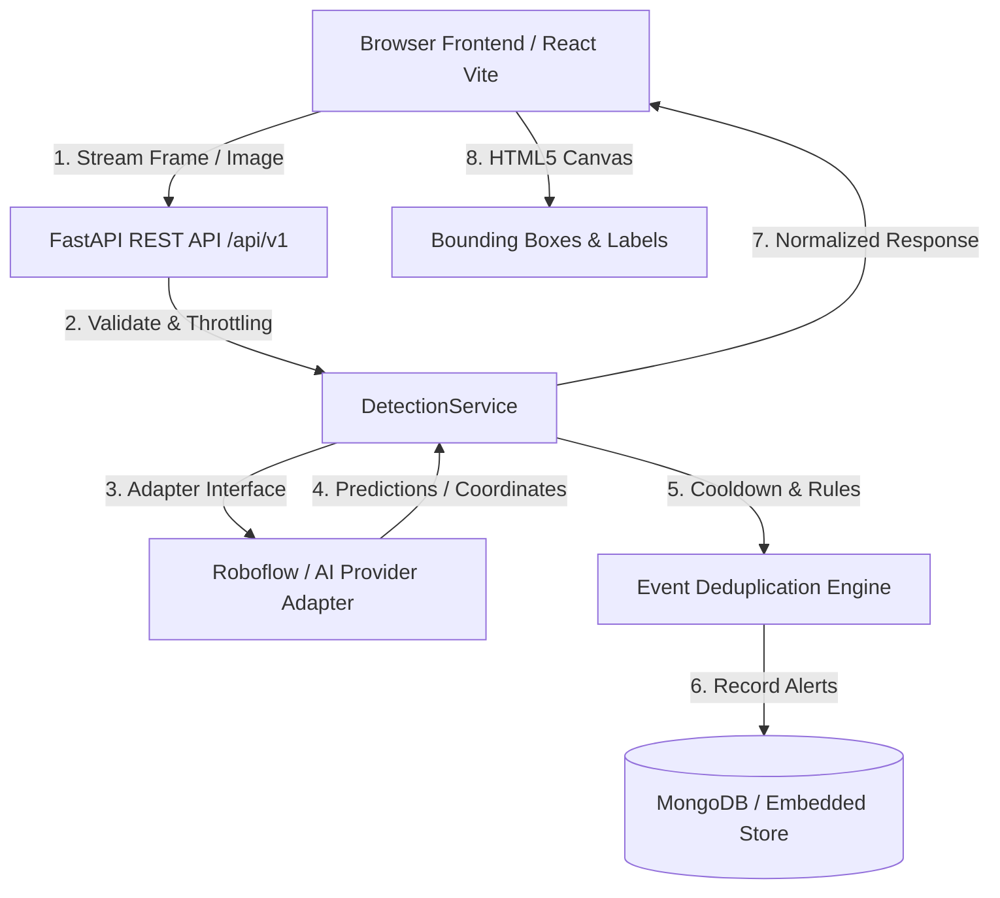

# MaskGuard AI — System Architecture Specification

## 1. High-Level Architecture Overview

MaskGuard AI is architected as an enterprise-grade full-stack computer vision monitoring application. The pipeline separates video capture, ingestion, AI inference, event processing, and data persistence to maintain high throughput, low latency, and zero alert saturation.

## 2. Component Pipeline

### 2.1 Frontend Layer
- **Framework**: React 18+ with Vite
- **Styling**: Tailwind CSS tailored to brand identity (`#102A43` Navy, `#0D9488` Teal, `#F8FAFC` Canvas)
- **Camera Capture**: WebRTC MediaDevices API capturing frames into an HTML5 offscreen canvas.
- **Overlay Engine**: Custom HTML5 Canvas rendering high-contrast bounding boxes (Green for Mask, Red for No Mask, Amber for Uncertain) with support for mirrored user previews.
- **Sequential Throttling**: Frames are sent one-at-a-time; the next frame is only captured and sent after the previous response returns plus a configurable delay (default 800ms).

### 2.2 Backend & Ingestion Layer
- **Framework**: FastAPI (Python 3.12 / 3.14) with Uvicorn ASGI server.
- **Security**: Argon2id password hashing, stateless JWT authorization with role-based checks (`admin` and `operator`).
- **Validation**: Strict Pydantic models verifying file types (JPEG, PNG, WebP) and maximum payload sizes (10MB limit).

### 2.3 AI Provider Adapter Layer
Implemented as an abstract protocol (`AIProvider`):
- `RoboflowMaskProvider`: Production integration connecting to Roboflow Inference API models (e.g., `mask-wearing-detection`).
- `DemoProvider`: Offline developer mode providing dynamic heuristic classification clearly stamped with "DEMO — NOT REAL AI DETECTION".
- `UnconfiguredProvider`: Explicit fallback when credentials are not supplied, raising code `AI_PROVIDER_NOT_CONFIGURED` with actionable instructions.

### 2.4 Event & Analytics Layer
- **Deduplication Cooldown**: Per-camera cooldown (default 15s) suppresses alert floods when an unmasked person remains in front of the camera.
- **Compliance Metrics**:
  $$\text{Mask Percentage} = \frac{\text{Mask Detections}}{\text{Mask Detections} + \text{No-Mask Detections}} \times 100$$
  Uncertain classifications are excluded from the denominator.
